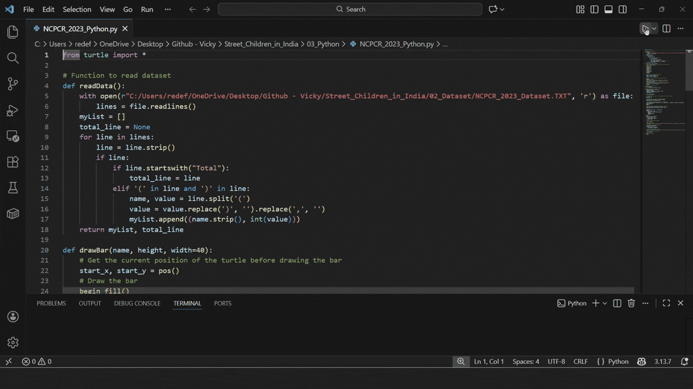
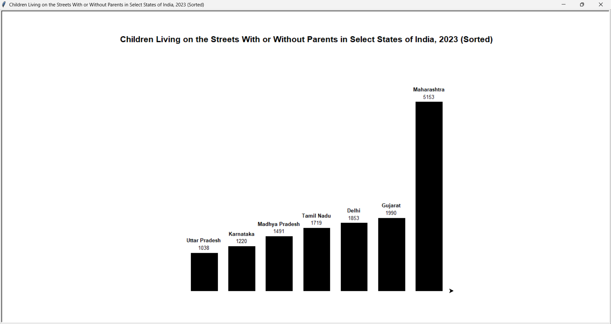
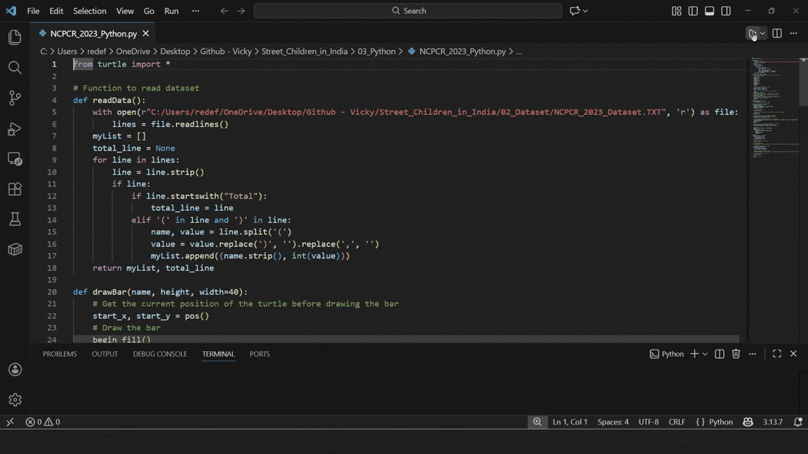
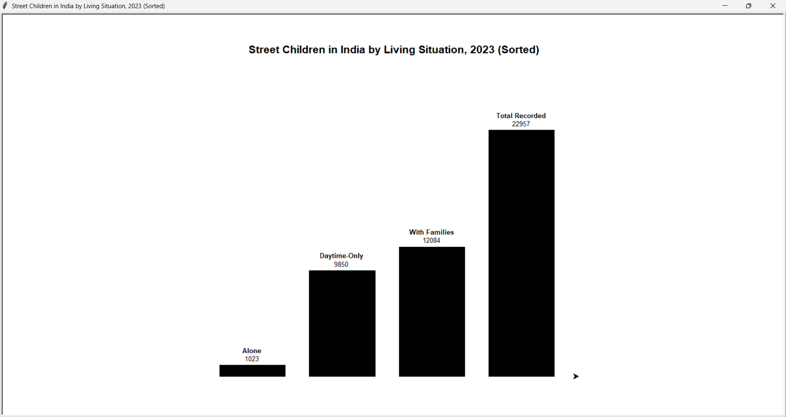

  <h1>🧸 Street Children in India</h1>

  

    Data visualizations examining street children in India
    by state and living situation.
  

<h2>📑 Table of Contents</h2>

<ul>
  <li><a href="#objective">Objective</a></li>
  <li><a href="#project-details">Project Details</a></li>
  <li><a href="#bar-graphs">Bar Graphs</a></li>
  <li><a href="#python">Python</a></li>
  <li><a href="#images">Images</a></li>
</ul>

<h2 id="objective">🎯 Objective</h2>

  This project uses data from the National Commission
  for Protection of Child Rights (NCPCR) and Child in
  Street Situations (CISS) Portal on the Baalswaraj
  platform to analyze the number of street children
  in India by state and living situation. It processes
  the dataset in Python and generates bar graphs
  (unsorted and sorted) using Turtle graphics for
  clear visualization.

<h2 id="project-details">🛠️ Project Details</h2>

  <strong>Tools:</strong> Python

<h2 id="bar-graphs">📊 Bar Graphs</h2>

  The project visualizes two datasets:
  street children living on the streets with or
  without parents in select Indian states, and
  street children in India categorized by living
  situation.

<h2 id="python">🐍 Python</h2>

  <a href="https://github.com/redefiningvicky/Street-Children-in-India/blob/main/03_Python/NCPCR_2023_Python.py">
    View NCPCR Python Script
  </a>
  &nbsp; • &nbsp;
  <a href="https://github.com/redefiningvicky/Street-Children-in-India/blob/main/03_Python/BSCiSS_2023_Python.py">
    View BSCiSS Python Script
  </a>

  
View Python Code Snippets

  <h3>Import Turtle</h3>

  <pre><code>from turtle import *</code></pre>

  <h3>Read Dataset</h3>

  <pre><code># Function to read dataset
def readData():
    with open(r"NCPCR_2023_Dataset.TXT", 'r') as file:
        lines = file.readlines()
    myList = []
    total_line = None
    for line in lines:
        line = line.strip()
        if line:
            if line.startswith("Total"):
                total_line = line
            elif '(' in line and ')' in line:
                name, value = line.split('(')
                value = value.replace(')', '').replace(',', '')
                myList.append((name.strip(), int(value)))
    return myList, total_line</code></pre>

  <h3>Draw Bar Graph</h3>

  <pre><code>def drawBar(name, height, width=40):
    # Get the current position of the turtle before drawing the bar
    start_x, start_y = pos()
    # Draw the bar
    begin_fill()
    forward(width)
    left(90)
    forward(height)
    left(90)
    forward(width)
    left(90)
    forward(height)
    left(90)
    end_fill()</code></pre>

  <h3>Sort Data</h3>

  <pre><code># Function to sort data by value
def sortData(data):
    return sorted(data, key=lambda x: x[1])</code></pre>

<h2 id="images">🖼️ Images</h2>

<h3>Street Children on the Streets With or Without Parents in Select States of India — Animated Bar Graph</h3>

<table>
  <tr>
    <td>
      
    </td>
  </tr>
</table>

<h3>Street Children on the Streets With or Without Parents in Select States of India — Bar Graph</h3>

<table>
  <tr>
    <td>
      
    </td>
  </tr>
</table>

<h3>Street Children in India by Living Situation — Animated Bar Graph</h3>

<table>
  <tr>
    <td>
      
    </td>
  </tr>
</table>

<h3>Street Children in India by Living Situation — Bar Graph</h3>

<table>
  <tr>
    <td>
      
    </td>
  </tr>
</table>

  

    <a href="https://github.com/redefiningvicky/Technical-Projects">
      Back to Technical Projects
    </a>
    &nbsp; • &nbsp;
    <a href="https://github.com/redefiningvicky/redefiningvicky">
      Back to Portfolio
    </a>
  

